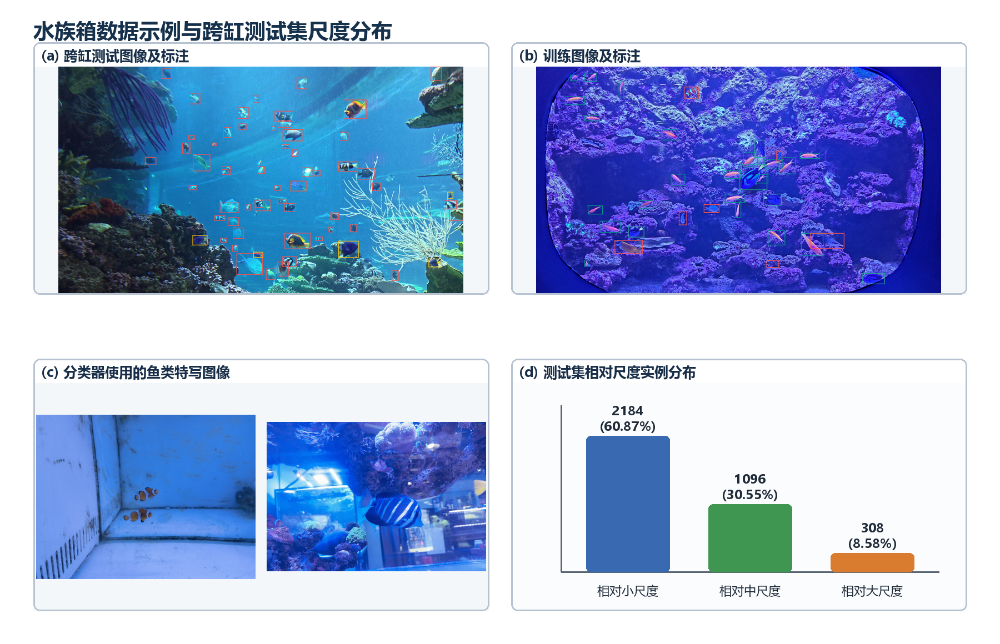
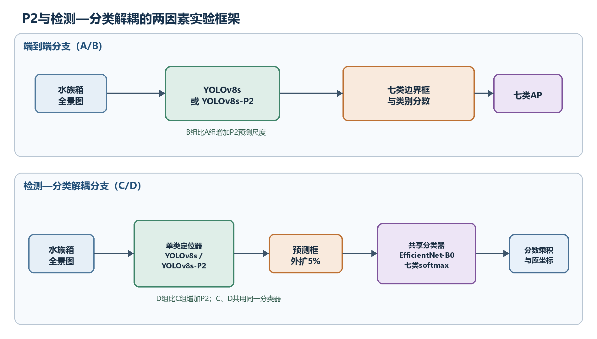
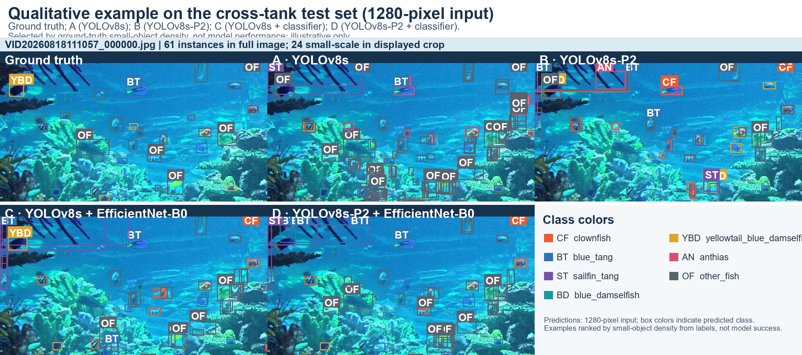
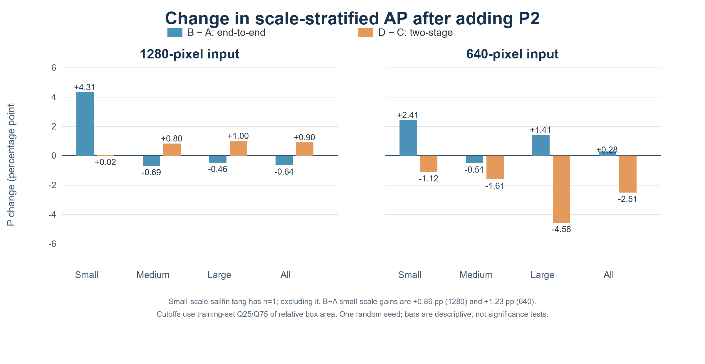

# 水族箱鱼类密集小目标检测与细粒度识别

比较浅层P2检测头与“先定位、后分类”的两阶段方案，观察密集、遮挡及细粒度类别相似场景中的收益和局限。

**作者：周锦鹏。相关论文获DAML2026录用。** 本仓库展示实验代码、归档指标及结果图，不把录用等同于出版或数据库收录。代码与材料整理使用AI编程助手辅助。



## 实验设计

自建目标域数据集共270张图像、7类；训练/验证/跨缸测试为161/14/95张。去重及同框类别冲突处理后共有6039个有效实例，测试集为3588个。分辨率640/1280各运行四组方案：

| 组别 | P2检测头 | 检测与分类解耦 | 方法 |
|---|---|---|---|
| A | 否 | 否 | YOLOv8s直接七类检测 |
| B | 是 | 否 | YOLOv8s-P2直接七类检测 |
| C | 否 | 是 | YOLOv8s定位 + EfficientNet-B0分类 |
| D | 是 | 是 | YOLOv8s-P2定位 + EfficientNet-B0分类 |

两个定位器采用各自同结构的FishDet-M预训练权重；C/D共用分类器。最终指标在同一95张测试图像上评估。



## 最终结果

| 输入 | A mAP@0.5 | B mAP@0.5 | C mAP@0.5 | D mAP@0.5 |
|---|---:|---:|---:|---:|
| 1280 | 0.2736 | 0.2665 | 0.3517 | **0.3739** |
| 640 | 0.1397 | 0.1395 | **0.2974** | 0.2570 |

1280-D较1280-A的mAP@0.5提高**10.03个百分点**，是整体系统对比，不将其单独归因于P2。结果直接来自[1280结果JSON](results/1280_test_metrics.json)与[640结果JSON](results/640_test_metrics.json)。

结论是：定位与分类解耦在这些设置下带来更一致的整体收益；P2具有条件性的尺度效应，没有稳定提升总体AP。不能由单一随机种子、小规模且不均衡的数据集推出普遍性能优势。



定性图按标注密度与类别多样性选取一个示例，用于观察差异，不代表随机抽样或平均效果。

## 尺度分析

尺度阈值只用训练集相对框面积的25%/75%分位数确定。测试集小/中/大尺度实例数为2184/1096/308，尺度定义不直接等同于COCO的绝对面积标准。



分层中有稀疏类别，例如小尺度帆吊仅1个实例，宏平均AP会受其影响。完整结果见[尺度分层JSON](results/scale_stratified_ap.json)。

## 查看与复现

仅检查现有8组指标，无需安装深度学习框架：

```text
python scripts/summarize_results.py
```

训练和推理需要自备数据及权重，当前仓库未附完整数据或模型。运行步骤、目录、训练参数与路径整理说明见[复现说明](docs/reproduction.md)。仓库整理后的完整重训尚未执行，不将语法检查当作实验复现。

## 文件导航

- `scripts/train_aquarium_fishdetm_transfer.py`：修正后的同结构迁移训练。
- `scripts/train_classifier.py`：从原实验抽取的分类器训练流程。
- `scripts/evaluate_aquarium_two_stage.py`：四组系统的统一测试评估。
- `scripts/evaluate_aquarium_scale_ap.py`：训练集阈值与COCOeval尺度分层。
- `results/`：8组最终总体结果、训练清单与尺度结果。
- `configs/`：P2结构与数据集YAML示例。

## 局限与来源

目标域只有270张图像，测试类别分布不均；每种设置仅一个随机种子。未提供同一硬件条件下的统一延迟/FPS结论。

框架采用Ultralytics YOLOv8、PyTorch、torchvision和pycocotools；P2结构基于YOLOv8组件扩展。第三方框架、预训练模型及数据遵守各自授权，本仓库未重新分发它们或授予额外开源许可证。样例图来自本项目现有论文图表；完整论文、证件和录用函不随代码仓库分发。
